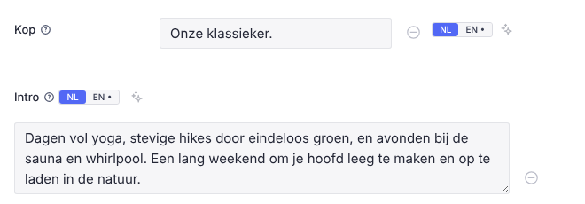
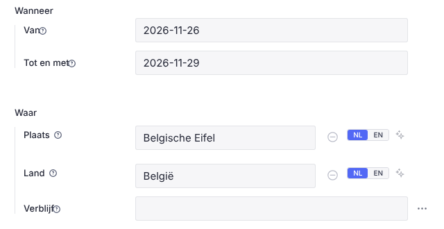

# Sanity Studio UX: best practices

What we changed compared with the classic Sanity Studio UI, why, and the pitfalls we ran into.
The editors (Rita & Philippe) are not technical and often edit on a phone. Every rule below
comes from something that confused them or took too much room.

Code references are relative to `studio/`.

---

## 1. Principles

1. **Explain where the value goes.** Every field says where it appears on the site (or in which
   mail, or "intern") and what it's for. Not "Titel", but "the big title on the card and in Google".
2. **Help on demand, not in the way.** Help texts sit behind a small ⓘ after the title, so long
   explanations cost no space.
3. **Dense but readable.** Short fields take one row (title left, input right). Long texts, lists and
   groups keep the full width.
4. **Keep Sanity's own behaviour.** Restyle Sanity's default field (`renderDefault`) rather than
   rebuilding it, so comments, the "…" menu, validation and change bars keep working.
5. **Fewer clicks in the navigation.** Put things one level higher when a sub-list only holds one or
   two items.
6. **Follow the page.** Tabs and overviews follow the order of the page on the site, top to bottom.
7. **No red for "not done yet".** Empty is not an error: in progress = blue, done = green. Red is for
   real validation errors.
8. **Dutch, plain, with examples** (“bv. …”) and the fallback when empty (“Leeg = …”).

---

## 2. Navigation (structure)

| Classic | Ours | Where |
|---|---|---|
| Type list → sub-list → documents (3 panels) | One panel with the page singleton on top + the documents under a heading per kind | `structure/index.ts` `liveList` (Formulieren, Mails, Lessen, Over ons), `components/RetreatList.tsx` (Retreats) |
| Separate lists for upcoming / past, new / published | One list with filter chips (Komend / Voorbij / Alle; Nieuw / Gepubliceerd / Geweigerd / Alle) | `RetreatList.tsx`, `StatusList.tsx` (Inschrijvingen, Contactformulier, Reviews) |
| Component panes fill the whole width | `S.component(...).maxWidth(400)` for list-like components | `structure/index.ts` |
| Generic "+" offers everything | `newDocumentOptions` / `schema.templates` filter out singletons, submissions and fixed docs | `sanity.config.ts` |
| Pink initials as workspace icon | The site icon as `icon` in `defineConfig` | `components/StudioLogo.tsx` |

**Navigation depth: at most two clicks to any document.** The classic structure tends to grow a
level per idea: "Formulieren" → "Inschrijfformulieren" → the forms → a form. Every extra panel costs
width (on a phone, a whole screen) and makes people lose track of where they are. Our rules:

- **Group → document.** The first panel holds the groups (Retreats, Formulieren, Mails, …); the second panel holds the documents themselves.
- **No sub-list with one or two items.** Pull them up: the page singleton goes on top of the document list (Retreats-pagina above the retreats, Inschrijving pagina above the forms), with a divider in between.
- **No separate lists per state.** Use filter chips in one list instead (Komend / Voorbij / Alle; Nieuw / Bevestigd / …).
- **Keep list panels narrow.** Give them a max width, so the document gets the room.
- **Mind the cost of a flat list.** A flat list made with `S.documentTypeListItem` directly in the root is not the same as "one level less": it moves the page singleton elsewhere. We tried that and reverted it. The singleton belongs with its documents.

**A live mixed list (static items + documents).** `liveList(S, id, title, top, parts, create)` in `structure/index.ts`: `top` = the singletons, `parts` = one heading per document type (with an optional `match` and `sort`, e.g. founders vs collaborators, `orderRank` as on the site), `create` = the "+" menu. Under the hood a child returns an Observable:

```ts
.child(() => {
  const client = S.context.getClient({ apiVersion });
  return client
    .listen(query, {}, { visibility: "query", includeResult: false, events: ["welcome", "mutation"] })
    .pipe(debounceTime(300), switchMap(() => client.fetch(query, {}, { perspective: "drafts" })),
      map((docs) => S.list().items([singleton(...), S.divider(), ...docs.map(...)])));
})
```

- Deduplicate drafts (`drafts.` prefix) and published documents by their published id.
- Add a "+" via `.menuItems([S.menuItem().intent({ type: "create", params: { type } })])`.
- `S.context` has no `documentStore`: use `getClient`.
- Add `rxjs` to the Studio's own dependencies.

**Singletons:** a fixed `documentId`, no duplicate/delete actions, and kept out of "new document".

---

## 3. Fields

### 3.1 Help behind a ⓘ (every field)
- Where: `components/InlineFields.tsx` (`Help`), wired in `components/I18nTabs.tsx` (`I18nTabsField` = `form.components.field`).
- How: render the field with `renderDefault({ ...props, description: undefined, title: <>{title}<Help text={description}/></> })`.
- Behaviour: opens on hover (desktop) and on tap (phone); a tap elsewhere closes it (a `pointerdown` listener on `document`).
- The tooltip: `Popover` from `@sanity/ui/popover`, with a max width of about 320px set on an inner div (setting it on the Popover itself is ignored).
- Every field has a description that answers two questions: **where on the site** and **what for**. Keep examples and "Leeg = …" in it.

### 3.2 One-row fields
- **Which fields:** short ones only: `string`, `number`, `url`, `date`, `slug`, `reference`, and one-line NL | EN.
- **Not:** `text`, booleans, option lists, arrays, objects, or fields with their own `components.input`. The exception is the NL | EN plugin's own input, which is allowed.
- **Layout:** a CSS grid on Sanity's own field markup: `title+ⓘ | input | "…"`. The header is unwrapped with `display: contents`.
  - The "…" card is `position: absolute` by default. Make it `position: static` or it floats away.
  - Use `align-items: center` and a narrow title column (`minmax(80px, 26%)`).
  - A container query (`< 300px`) stacks the title above the input again.
  - A negative `margin-block` pulls the rows together, because the form puts 32px between fields.
- **NL | EN fields:** the language tabs and the ✨ translate button move right of the input (the title column is too narrow). They are passed via React context from the field to the input component.
- **Switch it off** for part of a form with `<InlineFields.Provider value={false}>`.

### 3.3 Languages (sanity-plugin-internationalized-array)
- Show one language at a time with small NL | EN tabs. A dot on a tab means empty; red or amber means an error or warning in that language.
- Hide the other languages with `display: none`, never by leaving them out of `members`. Leaving them out broke the add and translate actions.
- One "Vertaal" (✨) button per field, plus a bulk translator.
- **Previews:** never select an i18n field raw as `title`. It is an array, so Sanity logs *“The "title" field should be a string…”*. Use `pick(value)` in `prepare`.
  - This also applies to Presentation `defineLocations` selects. We removed `locations` entirely: the "Gebruikt op x pagina's" banner only took room.

### 3.4 Better inputs for common patterns
| Pattern | Input | Where |
|---|---|---|
| Object of on/off options | One compact list of switches (title + ⓘ) instead of a box per toggle (`options.columns` made ragged boxes) | `FormBuilder.tsx` → `ToggleListInput` |
| Choosing a type | Tiles with an icon and a one-line explanation | `QuestionTypeInput` |
| “Show only if …” | Checkboxes of the previous question's answers instead of free text | `ShowIfInput` |
| Status | Radio buttons that also update the derived counts | `StatusInput.tsx` |
| Photo | A picker from the Fotobank (reuse + reset/delete) | `PhotoPicker.tsx`, `MediaBank.tsx` |

**Unset vs default.** For booleans, show `value ?? initialValue`, exactly as the site reads it (`coalesce(x, true)`, `!= false`). Otherwise an untouched toggle looks off while the site treats it as on. Done once for every lone on/off in `I18nTabsInput` (`form.components.input`), and in `ToggleListInput` for lists.

---

## 4. Documents

### 4.1 Large documents (a retreat, Home)
- **Groups:**
  - Groups in page order, each with an icon.
  - `default: true` on the first one, so the document doesn't open on "Alle velden".
- **Overview on top:** a custom root input (`components.input` on the document type) shows:
  - a progress bar;
  - the page from top to bottom, one tile per group: where it shows on the site, x/y filled, what is still empty, and how many texts have no EN;
  - clicking a tile calls `props.onFieldGroupSelect(group)`;
  - collapsible, with the choice stored in `localStorage`; collapsed, it explains only the open tab.
  - Where: `components/PageOverview.tsx` (`overviewInput({ label, sections, storageKey })`), used by the retreat and Home.
  - Optional groups (sign-up overrides, SEO) show "standaard" or "aangepast" and don't count toward the progress.
- **Fieldsets** ("Wanneer", "Waar", "Plaatsen & prijs") for grouping. Drop `columns` once fields are one row.
- **Derived values** are `readOnly` (e.g. `booked`). Add a manual correction field next to them (`bookedExtra`) and sum the two in GROQ, instead of letting people overwrite the derived number.

### 4.2 Flexible content
- Replace fixed fields ("retreats + one button") with an ordered array of block types, for example retreat/lesstijl reference cards, an own card, a button and extra text (newsletter "Onder de tekst").
- Give each block type a preview with an icon and a subtitle that says what it is.
- **Migration path:**
  1. Keep the old fields with `deprecated: { reason }` and `hidden: ({ value }) => !value`.
  2. Keep rendering them as a fallback.
  3. Ship a `content:vN` script that moves the data.

### 4.3 Mails
- Show the HTML preview as an inspector next to the form, in the language picked in the preview.
- Add a "test mail to yourself" button and a step indicator (write → test → publish → send).
- Mail texts are editable documents with defaults taken from the site dictionary (templates), so the Studio opens prefilled.

### 4.4 Submissions (sign-ups, messages, reviews)

Form submissions are documents people never "write" in the Studio. They read them, decide, and move on.
The classic form view (greyed-out read-only fields) is the wrong tool for that.

| Need | Ours | Where |
|---|---|---|
| See at a glance what's new | Live count bubble on the menu icon ("3" on Inschrijvingen) and a "Nieuw" badge on the document | `components/CountBadgeIcon.tsx`, `actions/badges.ts` |
| Find one quickly | One list per kind with status chips (with counts, opens on "Alle"), optionally per retreat, newest first. Each row has a coloured status badge: Nieuw = blue, Bevestigd / Beantwoord = green, Wachtlijst = amber, Geannuleerd / Geweigerd = red | `components/StatusList.tsx`, `components/StatusPreview.tsx` |
| Read it | The default view is a readable card (name, contact, answers as label/value), not form fields | `components/SignupView.tsx`, `components/SubmissionView.tsx` |
| Decide | Status buttons on that card plus an internal note. A sign-up's status also recomputes "Geboekt" on its retreat | `SignupView.tsx`, `lib/booked.ts`, `components/StatusInput.tsx` |
| Answer | "Bevestigingsmail" is the first action on a sign-up: preview it, then send (the waitlist version when full) | `actions/confirmation-mail.tsx` |
| Overview / export | Table view with one row per sign-up and one column per question, filter per retreat and status, CSV export. The same question across forms fills the same column (so harmonise labels) | `components/SignupTable.tsx` |
| Reviews | One list with status chips (Nieuw / Gepubliceerd / Geweigerd) and per retreat. A review comes in private (with e-mail) as `reviewSubmission`. Setting "Gepubliceerd" copies it without the e-mail to a public `review` (shown on the retreat page, and on Home from 4★). "Geweigerd" or back to "Nieuw" takes the copy offline. "Tekst op de site aanpassen" on a published one opens the public copy (an `IntentButton`). A "Reviewlink" action on a retreat gives the link to send to participants | `schemaTypes/documents/review.ts`, `structure/views.ts`, `actions/review-link.tsx` |

**Rules:**
- **No "duplicate" action on submissions.** A copy would get a public id.
- **Not in "new document".** They are only created by the site's forms.
- **Private ids.** Submissions holding personal data use dotted ids (`signup.<uuid>`), so they are never readable by the public API.
- **Status values are short words** with fixed colours, the same in the list, on the card and in the table.

---

## 5. Pitfalls in @sanity/ui and the Studio (versions in this repo)

| Pitfall | Fix |
|---|---|
| `Stack space={n}` → type error | This version uses `gap` |
| `Popover` not in `@sanity/ui` | `import { Popover } from "@sanity/ui/popover"`; it has no `onClickOutside`, so use your own listener |
| Icons inside `<Text>` scale with the text size | Set the size on the icon itself: `style={{ fontSize: 15, width: "1em", height: "1em" }}` |
| `all: "unset"` on a button removes your margin | Reset only what you need (`appearance`, `background`, `border`, `font`) and use padding for the gap |
| A colour set on a wrapper of an icon inside `Text` is ignored | Set `style.color` on the icon itself |
| `Card selected` turns the whole card blue and hides coloured text | Use a coloured border for "active" instead |
| The field "…" menu jumps to the bottom after a layout change | It is `position: absolute` inside the header; set `position: static` |
| Every field gets `components.input` from the i18n plugin | Don't treat "has a custom input" as "custom UI" for `internationalizedArray*` |
| `options.columns` on objects of booleans gives ragged boxes | Use a custom list input |
| `ObjectInputProps.onFieldGroupSelect` | Takes only `(groupName)` |
| A lone boolean ignores the field's `title`/`description` props: `BooleanInput` draws its own header from `schemaType` | Pass a changed `schemaType` (`description: undefined`, title + ⓘ) to `renderDefault` in the input component |
| Groups without `default: true` open on "Alle velden" | Every document with groups: `default: true` on the first, and an icon on each |
| The i18n plugin puts a ⊖ next to every language value (only on NL / EN fields, so some fields had one and others not) | It means "remove this language": one tap wiped the NL text the site shows. We hide it with CSS (`.i18n-tab-item > [data-ui="Card"] > [data-ui="Flex"] > :not(:first-child)`); emptying the box does the same on purpose |
| Typegen | `npm run typegen` after schema or query changes; GROQ with an interpolated `${CONST}` is fine |

---

## 6. Other tools that made a difference

| Problem with the classic Studio | Ours | Where |
|---|---|---|
| Drafts vs published confused people, and the perspective picker got an account stuck on "Gepubliceerd" | Releases and scheduled drafts are switched off: one flow, edit the draft, then Publiceren. "Zo werkt het" explains it in a few lines | `sanity.config.ts`, `components/Help.tsx` |
| Placeholder texts like “[IBAN]” went live unnoticed | Validation warns (yellow) on any text in [brackets], and "Nog in te vullen [ ]" lists every document that still has one | `schemaTypes/shared/i18n.ts` (`noPlaceholders`), `components/Placeholders.tsx` |
| English was always behind | ✨ per field, plus "Vertalen (AI)": every document with Dutch but no English, tick and translate in bulk into the drafts | `components/I18nTabs.tsx`, `components/BulkTranslate.tsx` |
| Images were uploaded again and again per document, without alt text | One Fotobank (`mediaItem`): tiles with search, filters and upload, and AI alt texts (NL + EN). Fields pick from it. "Andere foto uploaden" replaces a photo everywhere at once; "Verwijderen" only works once nothing uses it, and it lists where the photo is used | `components/MediaBank.tsx`, `components/PhotoPicker.tsx`, `schemaTypes/shared/media.ts` |
| SEO fields were blind | "SEO & delen" shows the Google snippet per language, with the same fallbacks as the site and length checks | `components/SeoPreview.tsx` |
| Not clear where a shared document is used | "Gebruikt door" on forms and mails lists the retreats using them (the default one: also the retreats that picked none) | `components/UsedByInput.tsx` |
| People were scattered over sign-ups, messages and subscribers | "Contactboek": one row per e-mail address with where it came from, newsletter on/off, CSV import and export | `components/ContactBook.tsx` |
| Editing blind | Live preview (Presentation) with drafts and click-to-edit, without the "Gebruikt op x pagina's" banner | `presentation/resolve.ts` |
| Mails were a black box | A preview of the HTML mail next to the form, a test mail to yourself, and editable texts with the site's defaults | `components/MailPreview.tsx` |
| Content changes across many documents by hand | Versioned scripts (`npm run content:vN -- --dry`, then for real) and `publish:drafts` (`--only=type`, `--skip-placeholders`). `--dry` prints what they would change first | `scripts/` |

## 7. Verifying without Sanity access

- Build the site with the offline fixture: `npm run fixture`, then `SANITY_FIXTURE=1 npm run build && npm start`. The embedded Studio lives at `/studio`.
- Drive the embedded Studio with Playwright and mock `*.sanity.io`:
  - answer `/data/query` with groq-js over the fixture;
  - answer `/data/doc`, `/users/me`, the ACL/grants endpoints and `/data/listen` (a welcome event).
- Screenshot at desktop width and at 412px. A phone is where most layout bugs show.
- Before reading the Studio console: preview warnings print the schema type and the offending `select` (search for "Check the preview config").

---

## 8. Appendix: the NL | EN tabs (code)



**How it works** (`components/I18nTabs.tsx`; the plugin is `sanity-plugin-internationalized-array`):

1. **Wiring:** three form-wide components, so every localized field gets tabs without touching any schema:
   - `field` holds the active language and draws the tabs;
   - `input` adds an "NL / EN toevoegen" button when the active language has no item yet;
   - `item` hides the other languages.
2. **One language at a time:** the items of the other languages get `display: none`. They are never removed from `members`; removing them broke the add and translate actions.
3. **Tab state:** a dot on a tab means that language is still empty; red or amber means a validation error or warning in that language.
4. **✨ Vertaal:** fills the English of this one field with an AI translation of the Dutch. On one-row fields, the tabs and ✨ move right of the input via context (`side`).
5. **Plugin header:** the plugin's own “NEDERLANDS / ENGLISH” header above each input is hidden with CSS, because the tab already says it.

```ts
// sanity.config.ts
internationalizedArray({
  languages: languages.map(({ id, title }) => ({ id, title })),
  defaultLanguages: [defaultLanguage],
  fieldTypes: ["string", defineField({ name: "text", type: "text", rows: 3 }), "simpleBlockContent"],
  buttonLocations: [], // adding a language: the tabs have their own button
  languageDisplay: "titleOnly",
}),
// …
form: { components: { field: I18nTabsField, input: I18nTabsInput, item: I18nTabsItem } },
```

```tsx
// the items of the other languages are only hidden, never left out of `members`
export function I18nTabsItem(props: ItemProps) {
  const active = useContext(ActiveLanguage)?.active;
  const lang = (props.value as Item | undefined)?.language;
  if (!active || !isItem(props.schemaType.name) || !lang) return props.renderDefault(props);
  return (
    <div className="i18n-tab-item" style={lang === active ? undefined : { display: "none" }}>
      {props.renderDefault(props)}
    </div>
  );
}

// the plugin's “NEDERLANDS” / “ENGLISH” header above each input: the tab already says it
const CSS = `.i18n-tab-item [data-ui="Flex"]:has(> [data-ui="fieldHeaderContentBox"] label[for$=".value"]) { display: none; }`;
```

<!-- include: components/I18nTabs.tsx -->

---

## 9. Appendix: the one-row field (code)



**How it works** (`components/InlineFields.tsx`, called from `I18nTabsField` = `form.components.field`):

1. **Which fields:** `isShort(props)` decides from the schema type chain: `string`, `number`, `url`, `date`, `slug`, `reference` and the one-line NL | EN. It never picks `text`, booleans, option lists, arrays, objects or custom inputs.
2. **Sanity's own field:** the field is rendered with `props.renderDefault(...)`, with the help moved behind the ⓘ in the title. Comments, the “…” menu, validation and change bars are untouched.
3. **CSS grid:** turns Sanity's header + input stack into `title | input | “…”`.
   - The header is unwrapped with `display: contents`.
   - The “…” card loses its `position: absolute`.
   - Everything is centred vertically.
4. **NL | EN fields:** the tabs and ✨ are passed to the input via context (`side`) and drawn right of it.
5. **Narrow columns:** a container query stacks the title above the input again below 300px.

```ts
// which fields get one row
export function isShort(props: FieldProps) {
  const chain = names(props.schemaType); // e.g. ["title", "internationalizedArrayString", "array"]
  if (props.name === "value" || chain.includes("text") || chain.includes("boolean")) return false;
  if ((props.schemaType.options as { list?: unknown[] })?.list?.length) return false;
  // own inputs (tiles, checkboxes) need the width; the NL | EN plugin's input is fine
  if (props.schemaType.components?.input && !chain.includes("internationalizedArrayString")) return false;
  return chain.some((n) => SHORT.has(n));
}

// Sanity's field markup: VStack [header Flex (fieldHeaderContentBox | “…” Card), input]
const ROW = `.inline-field [data-ui="VStack"]:has(> [data-ui="Flex"] > [data-ui="fieldHeaderContentBox"]):not(.i18n-tab-item *)`;
const HEAD = `${ROW} > [data-ui="Flex"]:first-child`;
const CSS = `
.inline-field { container-type: inline-size; margin-block: -10px; }
${ROW} { display: grid !important; grid-template-columns: minmax(80px, 26%) minmax(0, 1fr) auto; column-gap: 8px; align-items: center; }
${HEAD} { display: contents !important; }
${HEAD} > [data-ui="fieldHeaderContentBox"] { grid-column: 1; grid-row: 1; }
${HEAD} > :not([data-ui="fieldHeaderContentBox"]) { grid-column: 3; grid-row: 1; position: static !important; inset: auto !important; }
${ROW} > :not(:first-child) { grid-column: 2; }
${ROW} > :nth-child(2) { grid-row: 1; }
@container (max-width: 300px) { /* title on top again */ }
`;

export function InlineField({ props, title }: { props: FieldProps; title?: ReactNode }) {
  const t = title ?? <>{props.title}{props.description ? <Help text={props.description} /> : null}</>;
  return (
    <div className="inline-field">
      <style>{CSS}</style>
      {props.renderDefault({ ...props, description: undefined, title: t as unknown as string })}
    </div>
  );
}
```

```tsx
// I18nTabs.tsx: the field component decides; NL | EN fields pass their tabs + ✨ to the input
export function I18nTabsField(props: FieldProps) {
  const inline = useInlineFields() && isShort(props);
  if (!isArray(props.schemaType.name)) {
    if (inline) return <InlineField props={props} />;
    if (props.description && props.name !== "value")
      return props.renderDefault({ ...props, description: undefined, title: (<>{props.title}<Help text={props.description} /></>) as unknown as string });
    return props.renderDefault(props);
  }
  return <TabsField {...props} inline={inline} compact />;
}
```

<!-- include: components/InlineFields.tsx -->

